# Языки программирования
## Лабораторная работа 5

### Задание 1 **(2)**
*Переведите в двоичную запись два произвольных рациональных числа (числа вида* $\frac{p}{q}$).
*У одного из чисел знаменатель должен быть степенью двойки (32), а у другого --- некоторым числом
от 9 до 12.*

*Запись второго числа будет содержать период. Его надо найти. При решении задачи нельзя 
использовать вычислительную технику. Процесс решения должен быть представлен в отчете.*

### 101/32

10/32 < 1 .0

20/32 < 1 .00

40/32 > 1 40/32 -1 = 

8/32       .001

16/32 < 1 0.0010

32/32 = 1 0.00101

0

### 30/11 = 2 + 8/11

2 = $(10)_2$

8/11

16/11 > 1 16/11 = 1 + 5/11

10/11 < 1       = 0+10/11

20/11 > 1       = 1+9/11

18/11 > 1       = 1+7/11

14/11 > 1       = 1+3/11

6/11  < 1       = 0+6/11

12/11 > 1       = 1+1/11

2/11  < 1       = 0+2/11

4/11  < 1       = 0 + 4/11

8/11  < 1       = 0+8/11

0.|1011101000|

10.|1011101000|


### Задание 2 **(3)**
*Переведите в двоичную запись и найдите машинное представление в типе* **double**
*для произвольного вещественного числа большего, чем 100 с одним знаком после точки, например
для* $113.7$. *Цифра после точки не должна быть нулем иля пятеркой.*

*При решении задачи нельзя 
использовать вычислительную технику. Процесс решения должен быть представлен в отчете.*

### 113.7

113 = 1110001
113/2 = 56 1
56/2= 28   0
28/2 = 14  0
14/2 = 7   0
7/2 = 3    1
3/2 = 1    1
1 /2 = 0   1

0.7
1.4=1+0.4
0.8=0+0.8
1.6=1+0.6
1.2=1+0.2
0.4=0+0.4
0.1|011|
1110001.1|011|

### Задание 3 **(3)**
*Найдите сумму и произведение для записанных далее пар чисел. Числа заданы в двоичной записи 
в экспоненциальном виде. Ответ необходимо записать в нормализованннои экспоненциальном виде.*

* 1.0011e18 и $1.1001e21;

Сумма:

0.0010011000 * $2^{21}$
\+
1.1001000000 * $2^{21}$ 
\=
1.1011011000 * $2^{21}$

Ответ: 1.1011011e21
=
Произведение:

1.0011 * $2^{18}$
\*
1.1001 * $2^{21}$ 
\=
1.11011011 * $2^{39}$

Ответ: 1.11011011e39
=

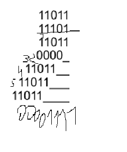
* 1.1011e-25 и, $1.1101e-23;

Cумма:
0.011011 * $2^{-23}$
\+
1.110100 * $2^{-23}$
\=
10.001111 * $2^{-23}$

Ответ: 1.0001111e^-22
=
Произведение:

1.1011 * $2^{-25}$
\*
1.1101 * $2^{-23}$
\=
11.00001111 * $2^{-48}$

Ответ: 1.100001111e-47
=

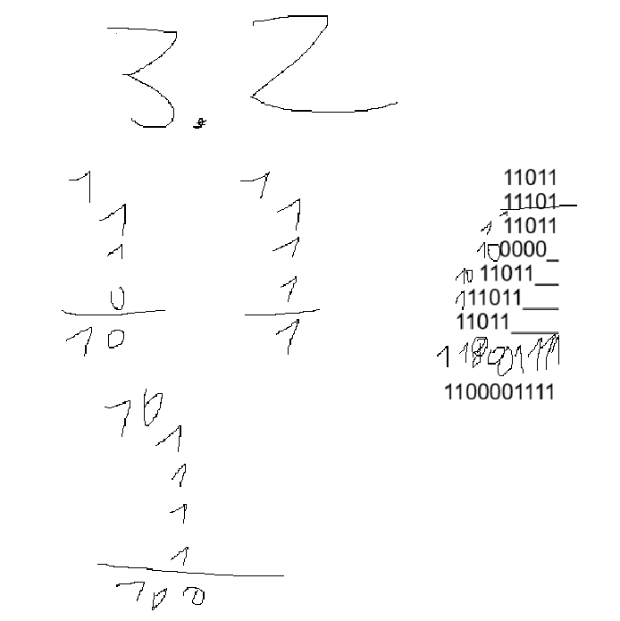


* 1.1011e-3 и $1.1011e1.

Сумма:

0.00011011 * $2^{1}$
\+
1.10110000 * $2^{1}$
\=
1.11001011 * $2^{1}$

Ответ: 1.11001011e1
=

Произведение:

1.1011 * $2^{-3}$
\*
1.1011 * $2^{1}$
\=
10.11011001 * $2^{-2}$

Ответ: 1.011011001e-1
=
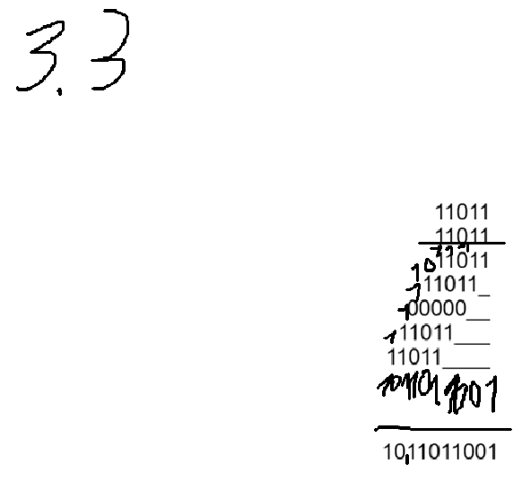

*При решении задачи нельзя 
использовать вычислительную технику. Процесс решения должен быть представлен в отчете.*

### Задание 4 **(2)**

*Рассмотрим следующий пример в IDLE Python*
```
>>> x = 99.99
>>> int(x/10+0.001)
9
```
double в питоне 64 бита, близок к double в c++(для себя)

*Результат должен был быть равен 10, однако оказался другим. Почему так произошло?

* Проблема в том что все числа с плавающей точкой в питоне хранятся примерно, то есть, x хранит не 99.99, а 99.9999999999999999983. И аналогично 0.001 хранится примерно как 0.001999999999999999999999932131231. А с помощью явного приведения типов в Python (int(число)) мы просто отбрасываем дробную часть. И, например если мы уберём int из этой программы то мы убедимся в моих словах(см. скрин 1). 
  
Вывод: числа с плавующей точкой хранятся только примерные, но не точные, поэтому использовать явное приведение типов чтобы округлять, результаты вычислений это неудачная идея.

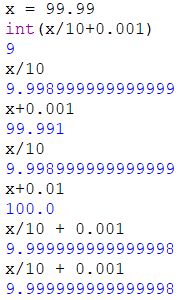

Как исправить программу, чтобы она корректно переводила вещественные числа в целые?*

* Чтобы наша программа корректно переводила вещественные числа в целые лучше всего будет воспользоваться встроенными функциями(см. скрин2)

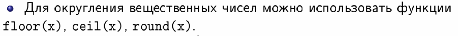

round - мат. округление при .5 округляет к чётным числам. (2.5 = 2, 3.5 = 4)
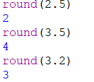

ceil - округленние вверх. (3.1 = 4)

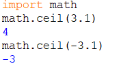

floor - округление вниз. (3.5 = 3)

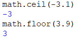

Исправленная программа(также в файле есть):

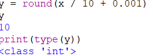

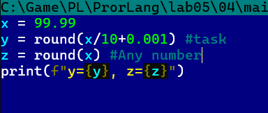

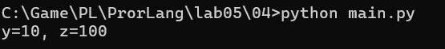


### Задание 5. **(2)**

*Рассмотрите следующую программу. Объясните результаты ее работы. В частности,
как величина* $y$ *повлияла на ответ?*
```
x = 1/3
y = 1
for i in range(20):
    print((x+y)-y)
    y*=10
```
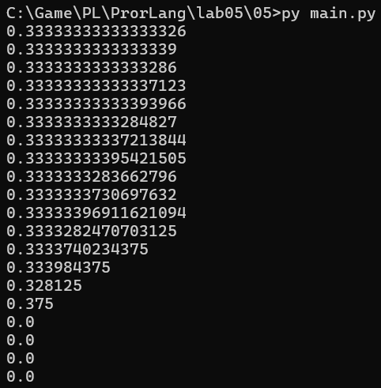

*В отчете требуется привести вычисления для оценки погрешности.*

Для начала надо найти нашу погрешность это наша esp 
как мы могли заметить, чем выше y тем выше погрешность => они находятся в линейной зависимости esp = y * $2^{-52}$. Соответсвтенно чем выше esp, тем легче прога не замечает потери точности. соответсвенно если esp = $2^{-52}$ то погрешность будет только на 53 символе(16-17 в десятичной системе), если esp = $2^{-40}$, то погрешность будет уже на 41 символе и т.д. Следовательно если x < esp то x потерян.

$2^{-52}$ ~ 2.22 * $10^{-16}$

0.33333333333333326 x > esp(2.22 * $10^{-16}$)

0.3333333333333339 x > esp(2.22 * $10^{-15}$)

0.3333333333333286 x > esp(2.22 * $10^{-14}$)

0.33333333333337123 x > esp(2.22 * $10^{-13}$)

0.33333333333393966 x > esp(2.22 * $10^{-12}$)

0.3333333333284827 x > esp(2.22 * $10^{-11}$)

0.33333333337213844 x > esp(2.22 * $10^{-10}$)

0.33333333395421505 x > esp(2.22 * $10^{-9}$)

0.3333333283662796 x > esp(2.22 * $10^{-8}$)

0.3333333730697632 x > esp(2.22 * $10^{-7}$)

0.33333396911621094 x > esp(2.22 * $10^{-6}$)

0.3333282470703125 x > esp(2.22 * $10^{-5}$)

0.3333740234375 x > esp(2.22 * $10^{-4}$)

0.333984375 x > esp(2.22 * $10^{-3}$)

0.328125 x > esp(2.22 * $10^{-2}$)

0.375 x > esp(2.22 * $10^{-1}$)

0.0 x < esp(2.22 * $10^{0}$)

0.0 x < esp(2.22 * $10^{1}$)
 
0.0 x < esp(2.22 * $10^{2}$)

0.0 x < esp(2.22 * $10^{3}$)

### Задание 6 **(2)**

*Для какого минимального значения* $n$ *программа на С++ выведет* **inf**? *Объясните
ответ.* *Что произойдет, если тип* **double** *заменить на* **long double**?
```
int n=...;
double s = pow(2, n);
std::cout << std::fixed << s << std::endl;
```
1024

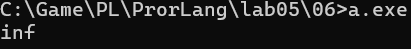

Спроси, ибо я не понял, это задание, тут тупо переполнение типа в случае с double, 
я не понимаю что тут надо писать, я напиши как понял но это сомнительно, это чисто для вопроса. Скажи: в инете нашёл что типо e1024 это уже inf там потому что ещё биты зарезервированы под NAN inf, а в остальном я просто не понима. вопроса.
=
просто переполнение типа double в doublde максимум = 1.8 * $10^{38}$. 2 в 1024 просто больше поэтому ошибка. long double просто больше и поэтому вмещает больше.
2^1024 ~ 1.798*10^308

в long double будет так 1.19*10^4932 переполнение всё равно будет inf, потому что pow(2, n) всё равно вернёт double и это неявное преобразование не сработает всё на скрине, что ничего не поменялось.

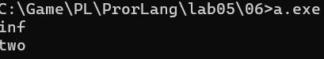

чтобы что-то поменялось там надо явное приведение в самом pow сделать типо такого 2L, или (long double).


### Задание 7 **(2)**

*Допишите что-либо вместо многоточия программе на С++, чтобы программа при запуске выдавала ответ* **yes**.
```
double s = 1;
if (s != s)
  std::cout << "yes";
```

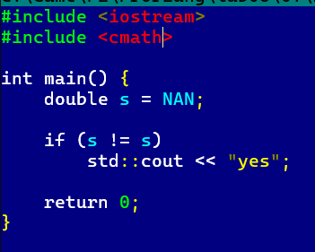
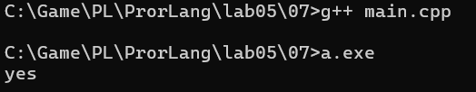

### Задание 8 **(2)**

*Какое минимальное натуральное число при преобразовании в тип* **double** *записывается с погрешностью? Объясните
ответ. Почему следующее за ним число уже выводится без погрешности?*
 
тут крч, прикол в том, что оно максимум вмещает 2^53, дальше уже шаг увеличивается с каждой степенью двойки, а до тех например 2^53 - точное, 2^53 + 2 точно и т.д., если число посередине между точными то округлятеся к тому у которого мантиса заканчивается на 0. Шаг сделан чтобы вместить больший диапозон чисел. и чем больше число тем хуже точность.

###  Задание 9 **(2)**
*Напишите программу для решения следующей задачи.*

*Даны четыре рациональных числа. (Рациональное число - это число вида*
$\frac{p}{q}$, *где* $p$ *и* $q$ - *целые числа.) Напишите программу, которая сравнит сумму
двух первых чисел с суммой двух последних чисел. Программа должна выводить* $1$, $0$ *или* $-1$
*в зависимости от результатов сравнения. Решение можно проверить в проверяющей системе*
[http://olymp3.isu.ru/cgi-bin/new-client?contest_id=102](http://olymp3.isu.ru/cgi-bin/new-client?contest_id=102), *задача 03*.

```py
t = int(input())
ans = []

for i in range(t):
    p1, q1, p2, q2, p3, q3, p4, q4 = map(int, input().split())
    a = p1 * q2 + p2 * q1
    b = q1 * q2
    c = p3 * q4 + p4 * q3
    d = q3 * q4

    if a * d > c * b:
        ans.append("1")
    elif a * d < c * b:
        ans.append("-1")
    else:
        ans.append("0")

print(" ".join(ans))
```

## Дополнительные задания

### Задание 1 **(3)**

*Чем отличаются машинные представления чисел* $1$, $4096$, $0.0625$, *в типе* **double**? *Почему?*

### Задание 2 **(4)**
*Напишите программу для решения следующей задачи.*

*Даны четыре вещественных числа
a,b,c,d, не превосходящие 100 по модулю, записанные не более чем с 10 знаками после точки.
Требуется сравнить суммы a+b и c+d и определить, какая из них больше. Возможен случай,
что суммы будут равны.* 

*От вас требуется обосновать выбор значения* **eps** *при сравнении.*

### Задание 3 **(5)**
*Задано вещественное число в десятичной записи. Напишите программу для нахождения первых 1000 разрядов
этого числа в двоичной записи.*


### Задание 4 **(3)**
*Изучая чужой код, программист обнаружил такую функцию.*
```
long double acos_e(long double x, long double ep){
  if (x > 1+ep || x < -1-ep)
    return 0.0 / 0.0;
  else if (x>1)
    x=1;
  else if (x<-1)
    x=-1;
  return acos(x);
}
```
*Чем отличается эта функция от обычной функции арккосинуса? В чем смысл дополнительных проверок?*
### Задание 5 **(5)**
*Заданы координаты точек* $A$, $B$, $C$ *на плоскости. Координаты являются вещественными числами в диапазоне* $[0;10)$
*и содержат не более 6 знаков после точки. Используя формулу векторного произведения, напишите программу
для определения расположения* $C$ *относительно вектора* $AB$ *(слева, справа, на прямой).*

*От вас требуется обосновать выбор значения* **eps** при сравнении.*
